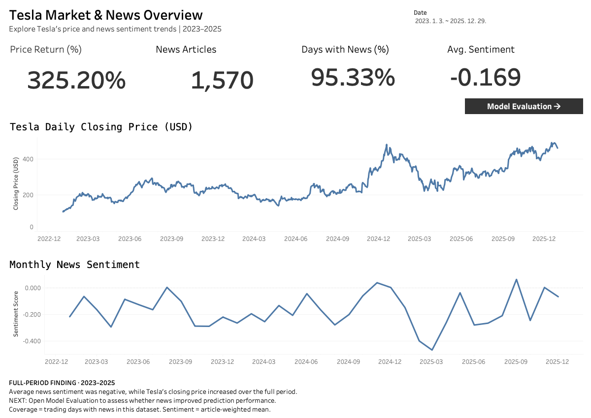
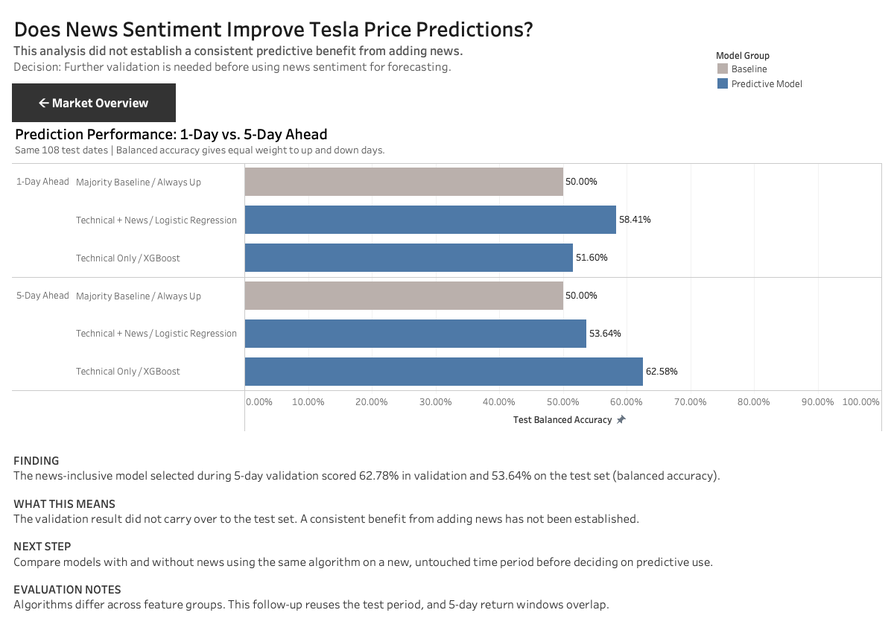

# Tesla Market & News Analytics

**Does adding news sentiment improve Tesla price-direction predictions?**

A Python and Tableau case study combining historical stock prices with news headlines to assess whether news features provide consistent predictive value.

[Open the Streamlit dashboard](https://tesla-stock-news-analysis-jbkagvqqtu4lbydrfw6kta.streamlit.app/) · [View the analysis notebook](Tesla_Stock_Analysis_final_reviewed_rev.ipynb)

## Decision summary

**Finding:** This analysis did not establish a consistent predictive benefit from adding news features. The news-inclusive Logistic Regression selected during 5-day validation scored **62.78% validation balanced accuracy**, falling to **53.64% on the test set**.

**Recommendation:** Further validation is needed before using these news features for forecasting. Compare the same algorithms with and without news on a new, untouched time period, with publication timestamps to verify that news was available at prediction time.

**Context:** The 5-day price-indicator-only XGBoost scored **62.58% test balanced accuracy**, compared with **50.00%** for the always-up baseline. This was an observed test result, not a reason to reselect the final model. Feature-group winners use different algorithms, so their test-score difference does not isolate the effect of news.

## Intended user and analytical workflow

The intended user is a market research analyst exploring Tesla's price and news trends and assessing whether news features warrant further forecasting research. This is a historical portfolio study; it does not claim a production deployment or measured business impact.

1. **Explore:** Review price returns, news availability and sentiment for a selected period.
2. **Evaluate:** Compare 1-day and 5-day prediction results against an always-up baseline.
3. **Decide:** Distinguish exploratory improvements from evidence sufficient for predictive use.

## Tableau dashboard

[Download the Tableau workbook (.twbx)](Tesla_Analytics_Portfolio.twbx?raw=true)

Open the downloaded workbook in Tableau to explore date filters, navigation and tooltips.

### Market & News Overview

Explore price returns, news coverage and sentiment across a selected date range.

### Prediction Evaluation

Compare prediction performance with the baseline and review the findings and recommended next steps.

*These are static dashboard previews. Filters, navigation and tooltips are available in the Tableau workbook.*

The Tableau workbook contains two linked views. A public viewing link is not yet included in this repository documentation.

| View | Question it supports | Main features |
|---|---|---|
| Market & News Overview | How did price and news sentiment change over the selected period? | Date filter, four KPI cards, daily closing prices, monthly sentiment and metric tooltips |
| Prediction Evaluation | Does the experiment support using news for prediction? | 1-day and 5-day test comparisons, baseline, sample size, findings, next steps and evaluation notes |

The date filter controls the market/news view. Model evaluation reports the fixed held-out test period; it is not recalculated by that filter.

### KPI definitions

| KPI | Definition | Full-period value |
|---|---|---:|
| Price Return | Last closing price / first closing price − 1 within the selected period; not annualized | 325.20% |
| News Articles | Number of collected, deduplicated articles assigned to the selected trading dates | 1,570 |
| Days with News | Share of trading dates with at least one article in this dataset | 95.33% |
| Avg. Sentiment | Article-weighted average headline sentiment; not an expected stock return | −0.169 |

Dashboard coverage: **2023-01-03 to 2025-12-29**, comprising **750 trading dates**. The stock source includes one additional trading day for target construction. Monthly sentiment at filtered boundaries may represent partial months. The full-period finding remains explicitly labeled when filters change.

### How to interpret model performance

- Balanced accuracy averages recall for the up and non-up classes. The always-up baseline scores 50%; this is not an investment-return measure.
- The follow-up compares both horizons on the same **108 test dates**, from **2025-07-22 to 2025-12-22**.
- The follow-up was designed after reviewing the original test results. It reuses that period and is exploratory, not fresh independent validation.
- Adjacent 5-day targets overlap. News publication times are unavailable, limiting verification of information availability.
- Same-algorithm news comparisons on the validation set and the complete test metrics are documented below.

## Tools and reproducibility

**Python · pandas · Tableau · Streamlit · scikit-learn · XGBoost · FinBERT · NLTK · yfinance**

The notebook includes preprocessing, exploratory analysis, model comparison and saved outputs. A full rerun requires the original news CSV, which must be supplied separately; dashboard exports alone are insufficient. See the detailed execution instructions below.

## Detailed methodology and results / 상세 분석

## Tesla 주가·뉴스 분석 및 1·5거래일 방향성 예측

[Streamlit 대시보드 보기](https://tesla-stock-news-analysis-jbkagvqqtu4lbydrfw6kta.streamlit.app/)

Tesla 주가와 Tesla·Elon Musk 관련 뉴스 헤드라인을 결합해 뉴스 감성·키워드와 주가 변동의 관계를 분석한 프로젝트입니다. 기존 다음 거래일 예측 실험에 이어, 예측 기간을 5거래일로 확장했을 때 뉴스 변수의 기여가 달라지는지 추가로 검토했습니다.

**결과 요약:** 추가 실험의 5거래일 기술지표 모델에서 기준 모델보다 높은 Test 균형 정확도를 관찰했습니다. 그러나 Validation에서 가장 우수했던 뉴스 감성 포함 모델의 개선은 Test에서 충분히 유지되지 않아, 뉴스 변수의 안정적인 예측 기여는 확인하지 못했습니다.

### 데이터

| 항목 | 범위 또는 규모 |
|---|---|
| 분석 기간 | 2023.01~2025.12 |
| 주가 | Yahoo Finance TSLA 일별 OHLCV, 751거래일 |
| 주가 날짜 | 2023-01-03~2025-12-30 |
| 뉴스 날짜 | 2023-01-03~2025-12-29 |
| 뉴스 원본 / 중복 제거 후 | 2,232건 / 1,570건 |
| 뉴스 확보 거래일 | 750일 중 715일, 95.33% |

뉴스 확보율은 뉴스 수집 마지막 날까지의 750거래일을 기준으로 계산했습니다. 2025-12-30 주가는 마지막 뉴스 날짜의 다음 거래일 타깃 계산에도 사용합니다.

### 분석 과정

#### 뉴스 전처리와 거래일 연결

- 언론사 접미사를 제거하고 동일한 정제 헤드라인의 최초 등장만 유지했습니다.
- 키워드 분석에는 소문자화, 특수문자·불용어 처리, 표제어 추출, 명사·형용사 필터링을 적용했습니다.
- 거래일 뉴스는 당일에, 주말·휴장일 뉴스는 다음 거래일에 연결했습니다.
- FinBERT에는 키워드용으로 가공한 텍스트가 아닌, 언론사 접미사를 제거한 자연어 헤드라인을 입력했습니다.

#### 키워드·감성 분석

일간수익률의 상·하위 20%를 급등·급락으로 정의하고, 뉴스가 있는 급등 147일과 급락 141일의 키워드 등장 여부를 비교했습니다. 카이제곱 검정과 Benjamini–Hochberg FDR 보정 후 5% 기준을 충족한 키워드는 0개였습니다. 워드클라우드와 상대 빈도는 탐색적 결과로 해석했습니다.

FinBERT로 헤드라인을 긍정·중립·부정으로 분류했습니다. 감성 점수는 선택된 긍정 라벨의 확률에 양수, 부정 라벨의 확률에 음수를 부여하고 중립은 0으로 계산했습니다. 중립 뉴스가 가장 많았으며, 급락일의 기사 단위 평균 감성이 가장 낮았습니다.

#### 기간별 탐색적 분석

일간 750개, 주간 157개, 월간 36개, 분기 12개 구간에서 주가 수익률·기사 수·평균 감성을 비교했습니다. 동일 기간 수익률과 평균 감성의 Pearson 상관계수는 주간 0.1965, 월간 0.4831, 분기 0.5052였습니다.

기간 수익률은 해당 기간의 첫 종가 대비 마지막 종가로, 평균 감성은 기사 수 가중 평균으로 계산했습니다. 시작·끝의 일부 기간을 포함하며, 분기는 12개 구간의 보조 분석입니다. 이 분석은 같은 기간의 연관성을 살펴본 것으로, 다음 기간 예측 실험과 구분합니다.

### 기존 실험: 다음 거래일 예측

현재 종가 대비 다음 거래일 종가가 상승하면 1, 상승하지 않으면 0으로 분류했습니다. 보합은 비상승에 포함했습니다.

모델링 표본 741행을 시간순으로 Train 518행, Validation 111행, Test 112행으로 나눴습니다. Logistic Regression, Random Forest, XGBoost에 다음 변수 조합을 적용하고, Validation 균형 정확도로 모델과 변수 조합을 선택했습니다.

- 기술지표만
- 기술지표 + 뉴스 변수
- 기술지표 + 뉴스 변수 + Train에서 선택한 키워드

기술지표는 `Daily_Return_pct`, `Close_to_MA5`, `Close_to_MA10`, `Volatility_5d`, `Volume_change_pct`입니다. 뉴스 변수는 기사 수, 평균 감성, 긍정·부정 기사 수입니다. 키워드는 학습 기간의 급등·급락 뉴스에서 선택한 뒤 날짜별 포함 여부로 사용했습니다.

**기존 실험의 최종 선택 모델은 기술지표만 사용한 XGBoost**이며, Validation 균형 정확도는 56.82%였습니다.

| Test 지표 | 선택한 XGBoost | 다수 클래스 기준 모델 |
|---|---:|---:|
| 정확도 | 49.11% | 54.46% |
| 균형 정확도 | 48.14% | 50.00% |
| Macro F1 | 0.4791 | 0.3526 |
| ROC-AUC | 0.5336 | 0.5000 |

기준 모델은 `DummyClassifier(strategy="most_frequent")`로, Train의 다수 클래스인 상승을 모든 Test 날짜에 예측했습니다. 선택한 XGBoost는 정확도·균형 정확도에서 기준 모델을 넘지 못했으며, Macro F1·ROC-AUC에서는 더 높았습니다.

### 추가 실험: 1거래일과 5거래일 비교

#### 실험 설계

예측 기간을 늘리면 뉴스 변수의 효과가 달라지는지 확인하기 위해, 현재 종가 대비 1거래일 및 5거래일 뒤 종가의 상승 여부를 예측했습니다. 이는 매일 계산하는 향후 5거래일 예측이며, 주별로 한 행씩 묶는 예측과는 다릅니다.

- 두 예측 기간에 동일한 입력 날짜를 사용했습니다.
- 기존 Validation·Test 시작 날짜를 유지하되, 5거래일 정답 기간이 다음 분할에 걸치는 관측치를 제외했습니다.
- Train 513행, Validation 106행, Test 108행을 사용했습니다.
- Test 입력 날짜는 2025-07-22~2025-12-22입니다.
- 기술지표만 사용하는 조합과 기술지표에 뉴스 변수를 더한 조합을 비교했습니다. 키워드는 이번 추가 실험에서 제외했습니다.
- 각 조합에서 3개 모델을 비교하고 Validation 균형 정확도 1위 모델을 선택했습니다. Train으로 학습한 상태에서 Test를 평가했습니다.

기존 실험과는 표본과 경계 처리가 다르므로, 추가 실험의 1거래일 결과도 기존 결과와 별도로 해석합니다.

#### 같은 모델에서 뉴스 변수의 추가 효과

아래 수치는 뉴스 포함 조합과 기술지표만 사용한 조합 사이의 **Validation 균형 정확도 차이**입니다.

| 모델 | 1거래일 변화 | 5거래일 변화 |
|---|---:|---:|
| Logistic Regression | +2.60%p | +5.26%p |
| Random Forest | −2.71%p | +1.75%p |
| XGBoost | −6.55%p | 0.00%p |

5거래일 예측에서는 일부 모델의 검증 성능이 개선됐습니다. 전체 5거래일 후보 중 Validation 1위는 뉴스 감성을 포함한 Logistic Regression으로, 균형 정확도는 62.78%였습니다.

#### Test 결과

| 예측 기간 | 변수 / 모델 | 정확도 | 균형 정확도 | Macro F1 | ROC-AUC |
|---|---|---:|---:|---:|---:|
| 1거래일 | 상승 고정 기준 모델 | 56.48% | 50.00% | 0.3609 | 0.5000 |
| 1거래일 | 기술지표 / XGBoost | 52.78% | 51.60% | 0.5158 | 0.5497 |
| 1거래일 | 기술지표+뉴스 감성 / Logistic Regression | 60.19% | 58.41% | 0.5829 | 0.5651 |
| 5거래일 | 상승 고정 기준 모델 | 62.04% | 50.00% | 0.3829 | 0.5000 |
| 5거래일 | 기술지표 / XGBoost | 62.96% | 62.58% | 0.6190 | 0.6665 |
| 5거래일 | 기술지표+뉴스 감성 / Logistic Regression | 58.33% | 53.64% | 0.5344 | 0.6068 |

기준 모델은 예측 기간별 Train의 다수 클래스를 사용하며, 이번에는 두 기간 모두 상승 고정 예측입니다. 정확도·균형 정확도는 백분율, Macro F1·ROC-AUC는 0~1 값으로 표기했습니다.

5거래일 기술지표 XGBoost는 기준 모델보다 균형 정확도가 12.58%p 높았지만, 일반 정확도 차이는 0.93%p였습니다. 반면 5거래일 Validation 1위였던 뉴스 포함 Logistic Regression의 균형 정확도는 Test에서 53.64%로 낮아졌습니다.

**Test에서 성능이 좋았다는 이유로 최종 모델을 XGBoost로 재선택하지 않았습니다.** 또한 Test 표의 변수 조합별 모델은 알고리즘도 다르므로, 두 행의 성능 차이를 뉴스 변수만의 효과로 해석할 수 없습니다.

### 주요 결론과 한계

- 뉴스 확보율은 높았지만, 급등·급락일 사이에서 FDR 5% 기준의 유의 키워드는 확인되지 않았습니다.
- 기존 1거래일 실험의 선택 모델은 Test 정확도·균형 정확도에서 기준 모델을 넘지 못했습니다.
- 추가 실험의 5거래일 기술지표 모델에서는 개선을 관찰했지만, 뉴스 변수의 안정적인 기여는 확인하지 못했습니다.
- 추가 실험은 기존 Test 결과를 본 뒤 설계한 후속 탐색 분석입니다. 새 독립 표본에서 확인한 성능으로 해석하지 않습니다.
- 5거래일 수익률은 인접 관측치끼리 기간이 겹치므로, 108개 Test 관측치를 서로 독립적인 108번의 실험으로 볼 수 없습니다.
- 뉴스 발행 시각이 없어 예측 시점의 정보 가용성을 완전히 보장할 수 없습니다. 뉴스와 주가의 연관성은 인과관계를 의미하지 않습니다.
- 단일 종목과 한 Test 구간의 결과이므로, 새 기간에서 성능이 유지되는지 추가 검증이 필요합니다.

### 분석 파일과 대시보드

| 파일 | 역할 |
|---|---|
| [Tesla_Stock_Analysis_final_reviewed_rev.ipynb](Tesla_Stock_Analysis_final_reviewed_rev.ipynb) | 전처리·EDA·기존 모델 비교·추가 1·5거래일 실험 및 저장된 실행 결과 |
| [app.py](app.py) | Streamlit 대시보드 실행 코드 |
| `df_ml_final.csv` | 기존 실험의 모델링 데이터 |
| `selected_model.json` | 기존 1거래일 실험에서 선택한 XGBoost 모델 |
| `feature_importance.csv` | 기존 선택 모델의 변수 중요도 |
| `daily_eda.csv`, `weekly_eda.csv`, `monthly_eda.csv`, `quarterly_eda.csv` | 기간별 탐색적 분석 데이터 |
| `eda_keyword_summary.csv`, `sentiment_counts.csv`, `sentiment_by_daytype.csv` | 키워드·감성 분석 결과 |
| `requirements.txt` | 대시보드 실행 의존성 |

추가 실험 결과는 위 분석 노트북에서 확인할 수 있습니다. 노트북을 실행하면 `horizon_experiment_results.zip`에 분할 요약, Validation 결과, 뉴스 변수 효과, Test 지표, 날짜별 예측을 저장합니다.

`selected_model.json`은 기존 1거래일 실험의 선택 모델을 나타냅니다. 추가 1·5거래일 실험은 이 모델과 구분해 해석합니다. Tableau의 Prediction Evaluation 화면은 추가 실험의 저장된 Test 결과를 시각화합니다.

#### 분석 재실행

Colab에서 분석 노트북을 열고, 노트북이 읽는 원본 뉴스 파일 `테슬라_3년치_전체뉴스.csv`를 런타임에 업로드한 뒤 위에서부터 실행합니다. 원본 CSV는 별도로 준비해야 하며, 대시보드용 결과 CSV만으로 전체 분석을 재현할 수는 없습니다.

노트북은 주가와 FinBERT 모델을 외부에서 내려받습니다. 실행 시점의 데이터·라이브러리 환경에 따라 저장된 결과와 차이가 날 수 있습니다.

### 사용 기술

Python, pandas, Tableau, Streamlit, scikit-learn, XGBoost, FinBERT, NLTK, yfinance

본 프로젝트는 과거 데이터의 분석 및 예측 실험입니다. 실시간 매매 신호를 제공하는 시스템은 아닙니다.
